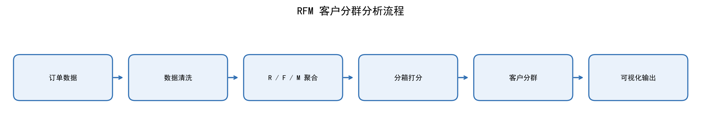
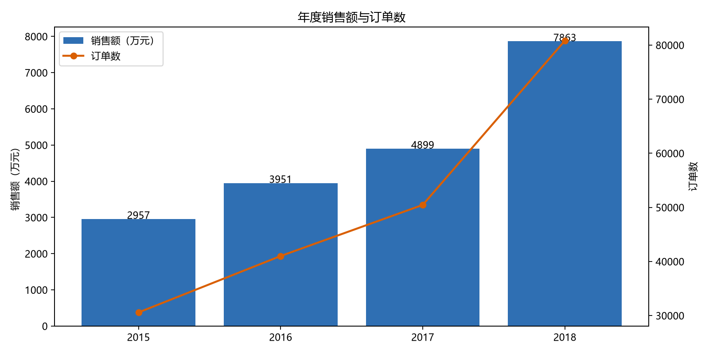
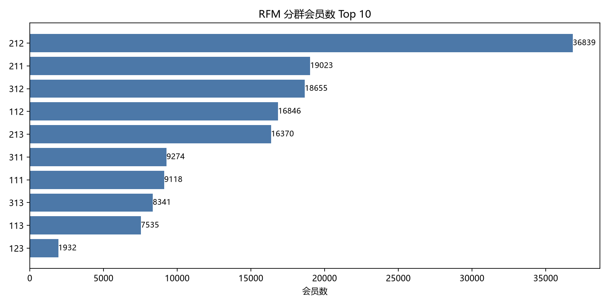
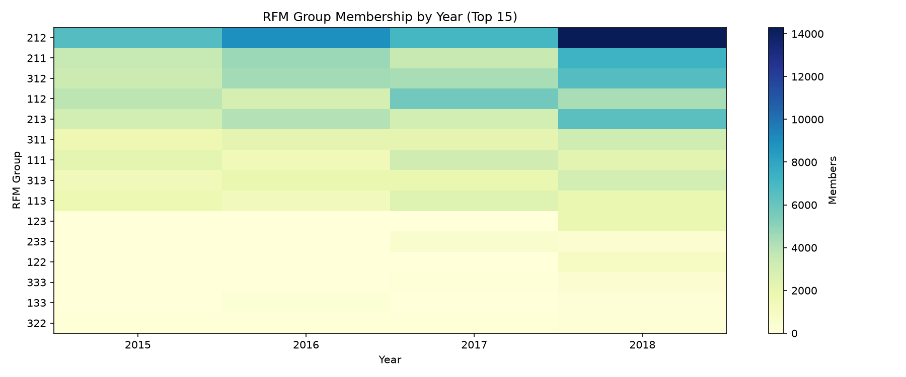
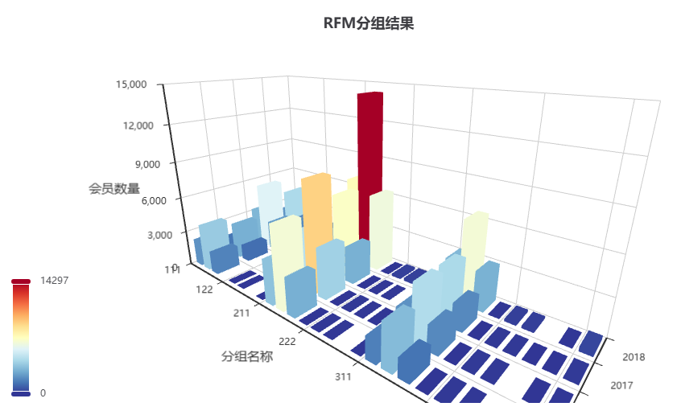

# 电商客户 RFM 分群分析

基于 2015—2018 年电商订单数据的 RFM 客户分层项目，包含数据清洗、R/F/M 打分、客户分群、年度销售分析和可视化。

## 项目概览

| 项目信息 | 内容 |
| --- | --- |
| 数据范围 | 2015—2018 年电商订单 |
| 数据规模 | 202,827 条订单，129,447 个会员 |
| 总销售额 | 19,669.6 万元 |
| 分析方法 | RFM 三维打分与分群 |
| 输出 | 年度销售趋势、RFM 分群图表、交互式 3D Dashboard |

## 目录

1. [项目背景](#项目背景)
2. [数据说明](#数据说明)
3. [分析流程](#分析流程)
4. [RFM 分箱规则](#rfm-分箱规则)
5. [分析结果](#分析结果)
6. [分群业务解释](#分群业务解释)
7. [环境要求](#环境要求)
8. [安装](#安装)
9. [快速开始](#快速开始)
10. [项目结构](#项目结构)
11. [说明](#说明)

## 项目背景

RFM 是客户关系管理中的经典分群方法：

- **R（Recency）**：最近一次购买距分析节点的时间；
- **F（Frequency）**：统计周期内购买次数；
- **M（Monetary）**：统计周期内购买金额。

对 R、F、M 分别打分并组合，可以识别高价值客户、潜力客户和流失风险客户，为精准营销、会员运营和流失预警提供依据。

## 数据说明

数据文件：data/sales.xlsx，包含 2015—2018 四个年度 Sheet 和一份会员等级表。

| 指标 | 数值 |
| --- | ---: |
| 订单总数 | 202,827 |
| 会员总数 | 129,447 |
| 总销售额 | 19,669.6 万元 |

年度分布：

| 年份 | 订单数 | 会员数 | 销售额（万元） |
| --- | ---: | ---: | ---: |
| 2015 | 30,574 | 27,611 | 2,957.3 |
| 2016 | 41,001 | 32,605 | 3,950.6 |
| 2017 | 50,451 | 34,267 | 4,898.7 |
| 2018 | 80,801 | 54,108 | 7,862.9 |

数据字段：

| 字段 | 说明 |
| --- | --- |
| 订单号 | 订单唯一标识 |
| 会员ID | 会员唯一标识 |
| 订单金额 | 订单实付金额 |
| 下单时间 | 订单创建时间 |
| 会员等级 | 会员所在等级 |

数据预处理规则：去除缺失值、过滤订单金额小于等于 1 的记录、以每年最后一天作为分析节点、按会员聚合 R/F/M。

## 分析流程

1. 读取 4 年订单数据和会员等级表；
2. 按年计算每笔订单距年末的时间间隔；
3. 按会员聚合得到 R（最近购买间隔）、F（购买次数）、M（购买金额）；
4. 对 R/F/M 分箱打分并拼接为 RFM 分组；
5. 统计年度销售趋势和 RFM 分群会员数；
6. 使用 PyECharts 生成 3D 柱状图。

## RFM 分箱规则

| 指标 | 分箱边界 | 说明 |
| --- | --- | --- |
| R | -1 / 79 / 255 / 365 天 | 距离年末越近，R 分越高 |
| F | 0 / 2 / 5 / 130 次 | 购买次数越多，F 分越高 |
| M | 1 / 69 / 1199 / 206252 元 | 消费金额越高，M 分越高 |

RFM 分组由三位评分拼接而成，例如 212 表示 R=2、F=1、M=2。

## 分析结果

### 年度销售趋势

2015—2018 年销售额和订单数持续增长，2018 年销售额约 7,863 万元，订单数约 80,000 单。

### RFM 分群 Top 10

212、211、312、112、213 等群体会员数量较多，可作为后续精准运营的重点对象。

### RFM 分群年度热力图

从年度热力图可以看到，头部群体的会员规模逐年扩大，2018 年多个核心分组出现明显增长。

### 交互式 3D Dashboard

完整交互式图表保存在 reports/rfm_dashboard.html，可用浏览器打开并旋转、缩放查看。

## 分群业务解释

| 分组特征 | 含义 | 运营建议 |
| --- | --- | --- |
| R 高、F 高、M 高 | 最近购买且高频高消费的核心客户 | 维护专属权益，优先推荐新品 |
| R 高、F 低、M 高 | 近期有高客单价购买，但频次不高 | 通过复购券提升购买频率 |
| R 低、F 高、M 高 | 曾经高频高消费，但近期沉默 | 重点召回，提供回归礼包 |
| R 低、F 低、M 低 | 长期未购买、低频低消费 | 低成本触达或暂缓投入 |

以上为通用解释，实际运营策略需结合会员等级、品类偏好和活动成本进一步细化。

## 环境要求

- Python 3.10+
- Jupyter Notebook
- pandas、numpy、openpyxl、matplotlib、pyecharts
- MySQL 导出功能需要 sqlalchemy、pymysql 和 MYSQL_PASSWORD 环境变量

## 安装

~~~bash
git clone https://github.com/Smasun0721/rfm-customer-segmentation.git
cd rfm-customer-segmentation
pip install -r requirements.txt
~~~

## 快速开始

~~~bash
cd notebooks
jupyter notebook rfm_analysis.ipynb
~~~

只重新生成 README 静态图：

~~~bash
python scripts/make_figures.py
~~~

## 项目结构

~~~text
rfm-customer-segmentation/
├── data/
│   ├── sales.xlsx
│   └── rfm_scores.xlsx
├── notebooks/
│   └── rfm_analysis.ipynb
├── reports/
│   ├── annual_sales.png
│   ├── rfm_group_distribution.png
│   ├── rfm_heatmap.png
│   ├── rfm_dashboard.png
│   └── rfm_dashboard.html
├── scripts/make_figures.py
├── docs/architecture.png
├── requirements.txt
└── README.md
~~~

## 说明

- 原始 Notebook 中的 MySQL 导出单元格已改为从环境变量 MYSQL_PASSWORD 读取密码，请不要将真实密码写入代码。
- 本项目基于原始 Pandas 课程案例整理，分析思路和 Notebook 代码保留原实现；数据授权请以原始课程或数据提供方为准。
- 数据文件约 15.6 MB，适合直接随仓库分发；如需替换为完整生产数据，建议改用数据库或对象存储。
